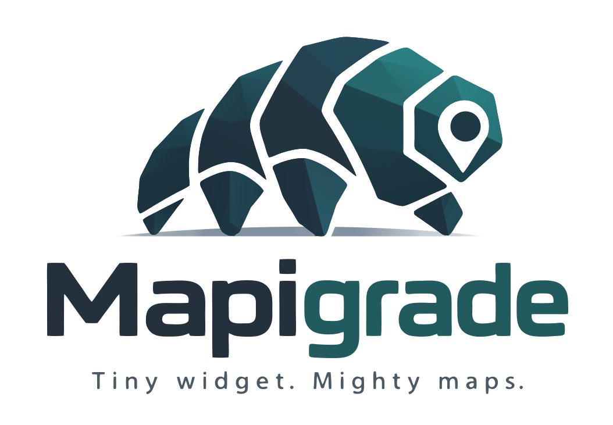

<p align="center">
  
</p>

# Mapigrade

A proof of concept that renders a MapLibre Native map on the GPU into a Flutter `Texture` widget on macOS and iOS, through MapLibre Native FFI, with no platform view and no CPU pixel readback. Flutter widgets placed above the map draw on top of it and receive input.

- Design and requirements: `openspec/specs/map-texture/` (requirements), `openspec/changes/archive/2026-10-09-macos-texture-vertical-slice/` (macOS) and `openspec/changes/ios-texture-vertical-slice/` (iOS)
- Measurements: `benchmarks.md`
- Limitations, licenses and what Android can reuse: `limitations.md`
- Follow-up for Flutter: `docs/flutter-texture-cache-followup.md`

## Repository layout

```
packages/flutter_mapigrade/              Flutter plugin (macOS and iOS)
  lib/src/texture/                       Dart API: MapTextureController, MapTextureView, @Native bindings
  lib/testing.dart                       test hooks and measurement helpers (not for applications)
  lib/src/layer/                         flutter_map layer (later change; empty)
  src/core/                              C++ core: map thread, commands, buffer state, C ABI (no Apple dependencies)
  darwin/flutter_mapigrade/              Swift package shared by macOS and iOS: Metal render target,
                                         FlutterTexture, plugin class, iOS lifecycle observers
  test/                                  Dart unit tests; test/native/ C++ unit tests for the core
example/                                 macOS and iOS example app, integration tests, benchmark, color check
  integration_test/                      spec scenarios (map_texture_test.dart), memory and color
                                         measurements (run with flutter drive)
  test_driver/                           driver for flutter drive
scripts/build_maplibre_ffi.sh            builds the pinned MapLibre Native FFI
scripts/maplibre_ffi.lock                the pinned FFI commit and presets
third_party/                             FFI checkout and build output (gitignored)
```

## Architecture

### Threads

```
 Dart (main isolate, platform thread)          map thread (one per map)                 Flutter raster thread
 ───────────────────────────────────           ─────────────────────────                ─────────────────────
 MapTextureController                          owns mln_runtime, mln_map,
   loadStyleUrl/Json, resize ──► ordered queue ──┐  mln_render_session
   setCamera ─────────────────► camera slot  ──┤
                  (both then mln_wake_source_signal)
                                               │ loop:
                                               │   mln_runtime_pump (parks until a wake)
                                               │   apply queued commands, then the latest camera
                                               │   drain events ── style loaded, loading failed,
   events stream ◄── NativeCallable.listener ◄─┤                   render error, idle
                                               │   if a render update is pending, Flutter has
                                               │   taken the latest frame, and a buffer is free:
                                               │     set_target to the free IOSurface buffer
                                               │     render_update into it
                                               │     (copyFree: false: render_update into the
                                               │      render texture, blit into the free buffer)
                                               │     publish it as latest
                                               │     textureFrameAvailable (via main queue)
                                               │                                        copyPixelBuffer:
                                               │                                          latest → presented,
   frames stream ◄── NativeCallable.listener ◄─┼──────────── frame displayed ◄─────────── return the buffer,
                                               └◄──────── wake (frame taken) ◄───────────  report its camera
```

Each loop iteration runs in an autorelease pool (`RunInPlatformScope`), so that Objective-C objects created on the map thread, such as each frame's command buffer, are released after the iteration. On iOS, the plugin pauses the map thread's rendering when the app enters the background and resumes it before the app enters the foreground, and asks the renderer to release cached resources after a memory warning.

Dart never calls MapLibre. It calls the plugin's C ABI (`src/core/map_texture_api.h`), whose functions only write to the command queue or camera slot and wake the map thread. The map thread is the owner thread of the runtime, map and render session, as the FFI requires. Camera updates coalesce in the slot, so the map renders the latest camera only. Consecutive resizes also coalesce.

### Frame path

```
MapLibre (Metal) ──render──► IOSurface-backed CVPixelBuffer (one of three: latest, presented, free),
                             through an MTLTexture made from its IOSurface
                 ──────────► FlutterTexture.copyPixelBuffer ──► Flutter composites it as a Texture widget

copyFree: false:
MapLibre (Metal) ──render──► private MTLTexture (BGRA8, one per size)
                 ──blit────► IOSurface-backed CVPixelBuffer, as above
```

Maps are copy-free by default (design D20): before each render, `mln_metal_borrowed_texture_set_target()` makes the free buffer's MTLTexture the session's target, and MapLibre renders directly into it. With `MapTextureController.create(copyFree: false)` or `MapLibreTextureLayer(copyFree: false)`, MapLibre renders into one private texture, and each frame is copied on the GPU into the free buffer (design D3b). In a continuous pan on the iPhone 15 Pro Max (2026-10-11), copy-free raised the median second from 98–101 to 109–111 fps and the lowest second from 83–88 to 98–104; 6.9–8.5% of rendered frames weren't displayed, against 3.0–5.4% with the copy, but copy-free still spent less render time per displayed frame. On an M2 Max Mac at 3200x2000 it gave no consistent gain, because `render_update` became about 0.7 ms longer, more than the copy (`benchmarks.md`).

No pixels pass through CPU memory, and the copy, if any, stays on the GPU. The three buffers ensure that the map thread never writes into the buffer Flutter displays or the one it displays next. The map renders only when MapLibre publishes a render update, and only after Flutter has taken the previous frame, so it renders nothing while the map is idle and no more frames than the display shows.

Each displayed frame is reported to Dart with the camera and size it was rendered with (`MapTextureController.frames`), taken from `mln_render_session_projection_create()` after the frame rendered.

## Pinned versions

| Component | Version |
| --- | --- |
| MapLibre Native FFI | commit `6f5a662093873a5a690de34fe21f6329b58e77e3`, presets `macos-arm64-metal`, `ios-arm64-metal` and `ios-simulator-arm64-metal` (`scripts/maplibre_ffi.lock`) |
| Flutter | 3.47.5 stable (framework `6a19cca564`, engine `ab598368592d`), Dart 3.13.4 |
| Xcode | 26.6 (17F113), macOS and iOS SDKs; deployment targets macOS 14.3 and iOS 15.5 |

The plugin uses Swift Package Manager, the native build integration that the Flutter 3.47.5 plugin template uses by default. It has no podspec, so CocoaPods builds are not supported.

## Prerequisites

- An Apple silicon Mac with macOS 14.3 or later
- Xcode 26.6 with the macOS and iOS SDKs, and an iOS simulator runtime
- Flutter 3.47.5 with macOS desktop support
- For an iPhone: iOS 15.5 or later, an Apple account added in Xcode (Settings > Accounts) for automatic signing, and the device paired with Xcode. The example's iOS project uses development team `2J9XYBV642`; change it in Xcode (Runner > Signing & Capabilities) for another team
- git and [mise](https://mise.jdx.dev) (`brew install mise`); the build script installs CMake, Ninja, Rust and cargo-about through mise
- CMake for the C++ unit tests (`brew install cmake`)

## Build and run

```sh
# 1. Build MapLibre Native FFI for macOS, iOS and the iOS simulator
#    (about 7 minutes on an M2 Max from a clean clone; a preset name as argument
#    builds only that preset)
scripts/build_maplibre_ffi.sh

# 2. Run the example app
cd example
flutter run -d macos
flutter run -d <simulator id>             # iOS simulator (arm64 only)
flutter run --release -d <iPhone id>      # iPhone; `flutter devices` lists the ids
```

The example shows the map with a control panel above it: style selection (OpenFreeMap Liberty, MapLibre demo tiles, and an invalid URL that shows the reported failure), zoom, rotate and pan buttons, and a continuous pan switch that changes the camera on every Flutter frame. `--dart-define=LOG_FRAMES=true` prints every displayed frame with its camera, and `--dart-define=CONTINUOUS_PAN=true` starts continuous pan at launch. On iOS, launching through `xcrun devicectl device process launch -e '{"MLT_KEEP_AWAKE":"1"}'` keeps the device from locking during scripted measurements.

## Tests

```sh
# C++ unit tests for the core (no MapLibre)
cd packages/flutter_mapigrade
cmake -S test/native -B build/native-tests
cmake --build build/native-tests
ctest --test-dir build/native-tests --output-on-failure

# Dart unit tests (including the check that lib/src/texture/ doesn't import flutter_map)
flutter analyze
flutter test

# Integration tests for the spec scenarios (about 40 s each, needs network access)
cd ../../example
flutter test integration_test -d macos
flutter test integration_test -d <simulator id>
# On an iPhone, flutter test can't start the app over a wireless connection; use flutter drive.
# Keep the iPhone unlocked with the screen on during the run.
flutter drive -d <iPhone id> --driver=test_driver/integration_test.dart \
  --target=integration_test/map_texture_test.dart
```

The iOS lifecycle tests use test hooks (`package:flutter_mapigrade/testing.dart`) that call the same functions as the background, foreground and memory warning handlers. The real notifications were checked on an iPhone (design D13, result).

## Measurements

```sh
cd example
# macOS (open brings the window to the front; a window behind others gets no frames)
flutter build macos --release --dart-define=BENCHMARK=true
open -W --env MLT_WINDOW_SIZE=1600x1000 --stdout result.txt \
  build/macos/Build/Products/Release/flutter_mapigrade_example.app

# iPhone (add --dart-define=BENCHMARK_SUSTAINED_S=300 for the 5-minute run)
flutter build ios --release --dart-define=BENCHMARK=true
xcrun devicectl device install app --device <device> build/ios/iphoneos/Runner.app
xcrun devicectl device process launch --device <device> --console \
  -e '{"MLT_KEEP_AWAKE":"1"}' com.greensopinion.mapigradeExample

# Memory and color measurements (any device)
flutter drive -d <device> --driver=test_driver/integration_test.dart \
  --target=integration_test/memory_measurement.dart
flutter drive -d <device> --driver=test_driver/integration_test.dart \
  --target=integration_test/color_measurement.dart
```

The benchmark pans over central London for 30 s to load the area, pans the same path again for 30 s while measuring, prints a line starting with `BENCHMARK_RESULT`, and exits. Results are in `benchmarks.md`.

Instruments' `xctrace` launches an app by its bundle identifier, which the Debug and Release builds share. Delete `build/macos/Build/Products/Debug/flutter_mapigrade_example.app` before tracing the Release build, or `xctrace` starts the Debug build.

## MapLibre Native FFI build details

The script:

1. clones `https://github.com/maplibre/maplibre-native-ffi.git` into `third_party/maplibre-native-ffi-src/` and checks out the pinned commit;
2. applies the local patches in `scripts/patches/maplibre-native-ffi-*.patch`, if any (currently none; the last one, needed by copy-free maps, was merged upstream as [maplibre-native-ffi#807](https://github.com/maplibre/maplibre-native-ffi/pull/807) and is in the pinned commit);
3. runs the FFI repository's `.mise/bin/sync-submodules`, which fetches MapLibre Native and the vendor submodules the build needs and applies the FFI's patches;
4. for each preset, runs `cmake --preset <preset>` and `cmake --build … --target install`, with CMake, Ninja, Rust and cargo-about installed by `mise exec` at the versions the FFI repository's `mise.toml` pins, and copies the install tree into `third_party/maplibre-native-ffi/<preset>/`;
5. wraps each installed preset's dylib in a framework and combines them into `MapLibreNativeC.xcframework` for the Flutter plugin.

Output in `third_party/maplibre-native-ffi/` (gitignored):

- `<preset>/lib/libmaplibre-native-c.dylib`, `<preset>/include/maplibre_native_c.h` and `<preset>/share/maplibre-native-c/` (the FFI license and third-party notices)
- `MapLibreNativeC.xcframework` with three slices: `macos-arm64` (a versioned framework, install name `@rpath/MapLibreNativeC.framework/Versions/A/MapLibreNativeC`), `ios-arm64` and `ios-arm64-simulator` (flat frameworks, install name `@rpath/MapLibreNativeC.framework/MapLibreNativeC`, minimum iOS 15.5); each has the headers and a module map

Measured on an Apple M2 Max, macOS 26.6.2, Xcode 26.6, from a clean checkout:

- `macos-arm64-metal` (2026-10-09): total wall time 239 s (clone, submodules, mise tool install, configure and build); configure and build alone 123 s
- `ios-arm64-metal` (2026-10-09): configure and build 88 s; `ios-simulator-arm64-metal`: 96 s
- `libmaplibre-native-c.dylib`: about 13 MB per preset (macOS 13,242,488 bytes, iOS 13,153,664 bytes, simulator 13,242,264 bytes), arm64 only

### Check the build with the upstream example

```sh
cd third_party/maplibre-native-ffi-src/examples/swift-map
export PKG_CONFIG_PATH="$PWD/../../build/macos-arm64-metal/install/share/pkgconfig"
swift build --product swift-map --scratch-path .build/macos-arm64-metal \
  -Xlinker -rpath -Xlinker "$PWD/../../build/macos-arm64-metal/install/lib"
.build/macos-arm64-metal/debug/swift-map borrowed-texture
```

The window shows a map of San Francisco.

## Packaging

`packages/flutter_mapigrade/darwin/flutter_mapigrade/Package.swift` declares `MapLibreNativeC.xcframework` as a binary target (through a symlink into `third_party/`), so Xcode links the framework into the app, embeds it in `Contents/Frameworks/` and signs it. The plugin's C++ core (`src/core/`, also a symlink) and the Metal bridge are compiled into the app executable, which exports the `map_texture_*` functions that Dart binds with `@Native`.

On iOS, Xcode embeds and signs the framework in `Runner.app/Frameworks/`. The example app is arm64 only, because the FFI presets are arm64 only: `ARCHS = arm64` in `example/macos/Runner/Configs/AppInfo.xcconfig`, and `EXCLUDED_ARCHS[sdk=iphonesimulator*] = x86_64` in `example/ios/Flutter/Debug.xcconfig` and `Release.xcconfig`.

iOS release build check (2026-10-10): the executable exports all `map_texture_*` functions that Dart binds (`dyld_info -exports`), it loads `@rpath/MapLibreNativeC.framework/MapLibreNativeC` with `@executable_path/Frameworks` as an `LC_RPATH` entry, and the release build displays the map on an iPhone 15 Pro Max.

Release build check (2026-10-09): `otool -L` on the executable shows `@rpath/MapLibreNativeC.framework/Versions/A/MapLibreNativeC`, the only `LC_RPATH` entries are `/usr/lib/swift` and `@executable_path/../Frameworks`, `codesign --verify --deep --strict` passes, and a copy of the `.app` outside the build directory starts and shows the map. In the release bundle, `MapLibreNativeC.framework` takes 12,884 KB of 49,952 KB.

## Color check

`example/lib/color_check.dart` (`flutter run -d macos -t lib/color_check.dart`) shows a map whose style has a `#3366CC` background and a `#E6B31A` fill, and Flutter swatches of the same colors below it. In a window screenshot (Display P3, 2026-10-09) the map and the swatches measured:

| Color | Map | Flutter swatch | Largest channel difference |
| --- | --- | --- | --- |
| fill `#E6B31A` | 222, 181, 67 | 222, 181, 67 | 0 |
| background `#3366CC` | 64, 101, 197 | 64, 100, 197 | 1 |

Both are within the 2/255 tolerance, so the IOSurface buffers need no explicit color space. On the iPhone, `example/integration_test/color_measurement.dart` renders the same screen to an image with `RepaintBoundary.toImage` and compares the pixels: the map and the swatches had identical values (fill 230, 179, 26; background 51, 102, 204; 2026-10-10).
