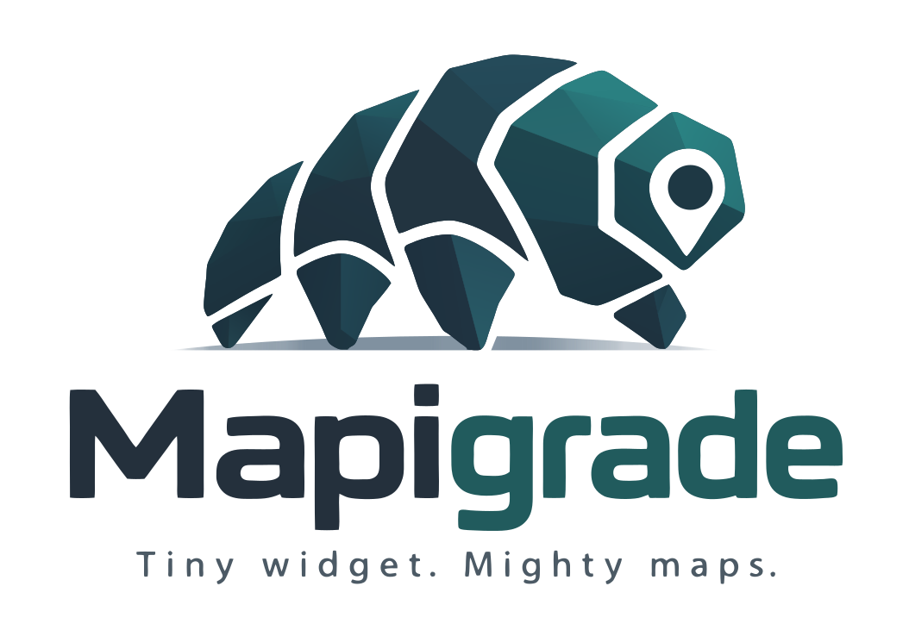

<p align="center">
  
</p>

# mapigrade

Renders a [MapLibre Native](https://github.com/maplibre/maplibre-native) map on its own thread into a Flutter `Texture` widget, through [MapLibre Native FFI](https://github.com/maplibre/maplibre-native-ffi).

`MapigradeMap` displays the map, with MapLibre's gestures and camera. The package also contains:

- `MapigradeController`, which controls everything about a map except its camera: in this version, feature queries and feature state;
- `MapigradePolylineLayer` and `MapigradePolyline`, which the map draws among the style's own layers, and `OverlayPlacement`;
- `MapigradeMetrics`, `HttpHeaderRule`, `QueriedFeature`, and `MapigradeException` with its subclasses.

The package is pre-1.0: the API can change between 0.x releases.

## Libraries

Import `package:mapigrade/mapigrade.dart`. It is the package's only API.

Applications must not import `package:mapigrade/src/integration.dart` or `package:mapigrade/src/testing.dart`: they aren't API, and they can change in any version.

## Placing the map

`MapigradeMap` fills the space its parent gives it. It takes a style URL or a style JSON string, and an initial camera:

```dart
import 'package:latlong2/latlong.dart';
import 'package:mapigrade/mapigrade.dart';

MapigradeMap(
  styleUrl: 'https://tiles.openfreemap.org/styles/liberty',
  initialCamera: const MapigradeCamera(
    center: LatLng(49.2827, -123.1207),
    zoom: 14,
    pitch: 50,
  ),
  onError: (exception) => debugPrint(exception.message),
  children: [
    // Widgets drawn above the map, such as MapigradeMarkers and
    // MapigradePolylineLayer.
  ],
)
```

`MapigradeCamera` has every field of MapLibre's camera, in MapLibre's conventions: center, center altitude, zoom, bearing, pitch, roll, field of view and padding. The zoom is that of 512-pixel tiles. A field that the initial camera omits gets MapLibre's default. `CameraLimits` sets the minimum and maximum zoom and pitch, and optional `GeoBounds` that the center stays within; by default the pitch is limited to 60 degrees.

`onStyleLoaded` is called each time a style has loaded. Failures are reported to `onError` as `MapigradeLoadException`, `MapigradeRenderException` or `MapigradeCreateException`. Where `Mapigrade.isSupported` is false, for example on web, the map reports one `MapigradeCreateException`, draws nothing, and still builds its children.

## Controllers

Create the controllers in a `State`, and give them to the map:

- `MapigradeCameraController` (`cameraController`) has the camera commands, the camera and the camera streams.
- `MapigradeController` (`controller`) has everything else: feature queries and feature state.

Each controller is attached to one map at a time, while that map is in the tree. A call on a controller that isn't attached, or whose map doesn't exist yet, fails with a `StateError`.

`MapigradeCameraController.camera` is the camera of the frame that the map displayed in the last Flutter frame, with every field set. `cameraChanges` emits a `CameraChange` for each displayed frame whose camera differs from the previous one, with a `CameraChangeSource` that states whether a gesture or a command moved it. `rests` emits the camera each time it comes to rest, once per rest.

## Camera commands

```dart
final outcome = await camera.flyTo(
  const MapigradeCamera(center: LatLng(45.83, 6.87), zoom: 13, pitch: 45),
  duration: const Duration(seconds: 3),
);
```

`jumpTo`, `easeTo`, `flyTo` and `fitBounds` complete with a `CameraTransitionOutcome` when their transition ends: `completed`, `cancelled` when `cancelTransitions` or a gesture stopped it, or `replaced` when a later command set every field it was still animating. A field that a command's camera leaves null keeps its value, so `easeTo(const MapigradeCamera(pitch: 0))` changes only the pitch.

## Markers

`MapigradeMarkers`, among the map's children, places widgets at coordinates:

```dart
MapigradeMarkers(
  markers: [
    MapigradeMarker(
      coordinate: const LatLng(49.2827, -123.1207),
      alignment: Alignment.bottomCenter,
      child: const Icon(Icons.location_pin, size: 40),
    ),
  ],
)
```

The child chooses its own size, and `alignment` names the point of the child that is placed at the coordinate. A marker moves with each displayed frame without rebuilding its child. A marker is upright by default. With `pitchAlignment: MarkerAlignment.map` it lies on the ground and the frame's perspective shortens it, and with `rotationAlignment: MarkerAlignment.map` its top points north, as MapLibre's `icon-pitch-alignment` and `icon-rotation-alignment` do. `scaleWithPerspective` scales an upright marker by the perspective at its coordinate. Markers farther from the camera are drawn behind nearer ones. A marker behind the camera, beyond the visible ground or off screen isn't drawn and receives no hit tests, and its child stays mounted.

Other descendants of the map read the displayed frame with `MapigradeFrame.of(context)`, which converts coordinates to positions and positions to coordinates with the projection that the frame was drawn with, and rebuilds them for each displayed frame.

## Taps and gestures

`onTap`, `onLongPress` and `onSecondaryTap` receive a `MapigradeTap` with the position relative to the map's top-left corner and the coordinate at that position, which is null above the horizon. The position is in the coordinate space of `MapigradeController.queryRenderedFeatures`. While double-tap zoom is on, `onTap` is called once a second tap is ruled out.

The map takes part in Flutter's gesture arena, so a marker's own `GestureDetector` wins a tap on the marker, and in a scrollable a one-finger drag goes either to the scrollable or to the map. Touch pans, pinches to zoom, twists to turn, moves two fingers up or down to change the pitch, double-taps to zoom in and two-finger-taps to zoom out, and glides on after a fast release. On macOS, a trackpad scroll pans, a trackpad pinch zooms and turns, the mouse wheel zooms, a right-drag or Ctrl-drag turns and tilts, a Shift-drag zooms to a box, and the arrow, `+` and `-` keys move the camera after a click on the map. `MapigradeGestures` turns each of these parts on or off. On iOS and Android, a gesture, glide or snap that moves the bearing to or across north plays haptic feedback, which `hapticFeedback: false` turns off.

## Supported platforms

Version 0.2.0-beta.1 supports iOS and macOS only. It uses a version of MapLibre Native FFI that has no release yet, and Android builds need the FFI's release from Maven Central. On Android, apps build and run, `Mapigrade.isSupported` is false, and a `MapigradeMap` reports a `MapigradeCreateException`. Android support returns with the first version that uses an FFI release.

To try the beta, add it with its version, because pub doesn't choose a prerelease otherwise:

```sh
flutter pub add mapigrade:0.2.0-beta.1
```

| Platform | Minimum version | Architecture |
| --- | --- | --- |
| iOS | 15.0 | arm64 (devices, and the simulator on Apple silicon Macs) |
| macOS | 14.3 | arm64 |

On iOS and macOS the plugin supports Swift Package Manager only; it has no podspec. Apps built for web build with the package, but it draws no map there.

The package contains no native libraries of MapLibre Native FFI. The first build on a machine downloads `MaplibreNativeC.xcframework.zip`, 17 MB, so it needs network access. It is a build of FFI commit `4371ff6` that we host as an asset of the GitHub release [`maplibre-native-ffi-4371ff6`](https://github.com/greensopinion/mapigrade/releases/tag/maplibre-native-ffi-4371ff6), not an official MapLibre release. Swift Package Manager checks it against the checksum that the package states, and caches it for later builds.
